# The Problem Log

*What problem we are solving, how we approached it, and every real problem we hit while building it, told in pictures.*

**Contents:** [1. The problem](#1-the-problem-in-three-pictures) · [2. Our approach](#2-our-approach-in-two-pictures) · [3. The build log](#3-the-build-log) · [4. Guardrails we built in advance](#4-guardrails-we-built-before-they-could-bite) · [5. What we learned](#5-what-we-learned) · [Sources](#sources)

---

## 1. The problem, in three pictures

### 1.1 The farmer keeps about a third

When a family in a city pays ₹100 for onions, about ₹36 reaches the farmer who grew them. The rest is spread along the chain of traders, transport and shops. A farmer cannot change that chain overnight, but she can choose **when** and **where** she sells. That choice is what we set out to support.

| Crop | Farmer's share of ₹100 |
| --- | --- |
| Tomato | ₹33 |
| Onion | ₹36 |
| Potato | ₹37 |

### 1.2 Prices move faster than farmers can check

At Lasalgaon, the average onion price fell from ₹4,451 to ₹3,900 a quintal between 1 and 6 October 2026, as imported onions and the new crop arrived. For a farmer holding 20 quintals, those five days were worth ₹11,020. Earlier the same season, many farmers sold at low prices because they needed cash or feared their stored onions would spoil.

| Date (2026) | Average price, ₹ per quintal |
| --- | --- |
| 1 October | 4,451 |
| 6 October | 3,900 |

### 1.3 Waiting has a cost too

Holding onions is a bet on the weather as well as the market. Dry onions keep best at 65–70% humidity; damper air brings rot, mould and roots. India loses an estimated ₹5,156 crore of onion a year after harvest.

| Category | Estimated loss, ₹ crore |
| --- | --- |
| Livestock produce | 29,871 |
| Fruits | 29,545 |
| **Vegetables** | **27,459** |
| *of which onion* | *5,156* |
| Cereals | 26,001 |
| Plantation crops | 16,413 |
| Oilseeds | 10,925 |
| Pulses | 9,289 |
| Eggs | 3,287 |

### The gap we found

The government's Bharat-VISTAAR assistant, launched in February 2026, already answers general farming questions in Hindi and English. Price apps already list mandi rates. What we could not find is one place that answers the money question directly: *given today's prices, the road to each mandi, my transport cost and the weather over my stored crop, where and when should I sell?* That narrow, practical question is our focus.

---

## 2. Our approach, in two pictures

### 2.1 One question, eight steps

1. **The farmer asks**, by voice or text, in English, Hindi or Marathi.
2. **Find the village.** We turn "Lasalgaon" into a point on the map.
3. **Check the week's weather.** Rain and humidity for the next seven days, at her village.
4. **Pull today's mandi prices** from the official Agmarknet feed on data.gov.in.
5. **Measure the road** to each nearby mandi that reported.
6. **Work out what she keeps** after transport. This step is ordinary code, not AI.
7. **Check every number.** Anything in the answer that is not in the live data is sent back to be fixed.
8. **Answer, out loud**, in her language, with a "How I decided" panel and sources.

The AI model (Sarvam-105B) is the planner and the explainer. It decides which step comes next and turns the results into plain sentences. It is never trusted with arithmetic or facts it was not given.

### 2.2 The money maths

The rule is simple enough to do on paper:

> **money kept per quintal = mandi price − (transport ₹ per km × road km ÷ quintals)**

The figure above uses round example numbers. In the app, every input is live: the price from Agmarknet, the distance from OpenStreetMap roads, and the transport rate from the farmer herself.

---

## 3. The build log

We built Mandi-Mausam between the evening of 31 October and the afternoon of 1 November 2026. Before building on any source, we tested it live. Several did not survive.

| # | When (IST) | What went wrong | Why | What we did | How we know it worked |
| --- | --- | --- | --- | --- | --- |
| 1 | 31 Oct, ~10:45 PM | Our AI pair-programmer's sandbox could not reach any outside API. | Its network only allows package downloads. | Ran every live check in a browser and terminal on our own laptop instead. | Open-Meteo returned a real Lasalgaon forecast: 80% chance of rain on 1 Nov. |
| 2 | 31 Oct, ~10:50 PM | Agmarknet 2.0's price report answered *"Captcha key and captcha value are required."* | The portal protects its price reports with a captcha. | We do not bypass captchas. We used the official data.gov.in API, which publishes the same Agmarknet data with a free key. The Agmarknet mandi and commodity lists, which need no captcha, confirmed the IDs: Onion is 23, Nashik is 361. | See row 3. |
| 3 | 1 Nov, morning | data.gov.in's "Preview" box stayed blank, and an older copy of the dataset page said its API "does not exist". | Unclear; the preview widget is separate from the API. | Generated our own key and queried the API directly. | Feed updated 11:30 AM IST on 1 Nov; every Maharashtra onion record was dated 01/11/2026. |
| 4 | 1 Nov, morning | A free community mirror of the same data looked like a good backup. | It had stopped syncing. | Rejected it as a source. | Its own metadata: last fetched 16 Oct 2026. |
| 5 | 1 Nov, ~11:40 AM | Loading our settings printed `command not found` followed by an API key. | A stray space after `=` in the `.env` file made the shell run the key as a command and print it. | Removed the space. Our checks now print only key lengths, never values. We stopped using that key. | Settings load cleanly; four variables found with the expected lengths. |
| 6 | 1 Nov, ~11:50 AM | The app said *"AI model is not responding."* | Our new Gemini key and the `gemini-flash-latest` alias hung for 40 seconds on both API routes; `gemini-2.5-flash` returned *"no longer available to new users"*. | Wrote two small check scripts, then switched to Sarvam-105B through its OpenAI-compatible API. The model is now a setting, not hard-coded. | Sarvam replied in 0.59 s with a correct tool call: `get_weather({"place": "Lasalgaon"})`. |
| 7 | 1 Nov, ~12:02 PM | First full run: every tool worked, but the answer card was empty. | The model's final reply was not usable JSON. | Three layers: clean the reply; if still unusable, ask again in strict JSON mode; if that fails too, show a plain summary built directly from the live data and say so. | Three new tests; 17 of 17 pass. |
| 8 | 1 Nov, ~12:02 PM | Only 5 onion price reports in all of Maharashtra by midday, none from Nashik. | It was Sunday; few mandis report, and this feed carries the current day. | We show the date of every price, rank fresh reports first, and never fill a gap with a guess. | The app showed the three Pune mandis that had reported, each marked "1 Nov". |
| 9 | 1 Nov, ~12:02 PM | "APMC Chattrapati Sambhajinagar" vanished from the comparison. | The city was renamed from Aurangabad; the map database still uses the old name. | Added a small, documented alias table for three renamed places (Aurangabad, Osmanabad, Ahmednagar). | Unit test: the mandi name now also searches as "Aurangabad"; the state filter keeps the match inside Maharashtra. |

---

## 4. Guardrails we built before they could bite

Some failures are predictable for any AI agent, so we designed against them from the start and tested them with scripted model replies.

| Risk | What could happen | Our guard | Tested by |
| --- | --- | --- | --- |
| Invented inputs | The model passes a transport rate the farmer never gave. | Quantity and transport rate are accepted only if the farmer typed them. | `test_full_loop_and_quantity_guard` |
| Invented numbers | The answer claims "prices will reach ₹5,200 next week". | Every number in the answer must exist in tool data; otherwise one fix-up round, then a visible warning. | `test_grounding_self_correction` |
| Bad arithmetic | The model miscalculates the money left after transport. | All money maths lives in `pricing.py`; the model only explains. | `test_pricing.py` |
| Stale prices | An old high price beats today's real one. | Reports older than 3 days are labelled and never ranked above fresh ones. | `test_stale_never_outranks_fresh` |
| Out-of-scope advice | A farmer asks for a pesticide dose. | The model is instructed to refer to KVK or the Kisan Call Centre. | Planned: our 30-question edge-case set |

---

## 5. What we learned

- **Test every source live before building on it.** Three of our six first choices failed, each in a different way.
- **A key format is not a contract.** Google's newer `AQ.` keys and model retirements changed what "a Gemini key" means for new accounts; keeping the model as a setting saved us.
- **Show the date of every number.** Mandi data is honest but uneven. Showing the date of each report beats hiding gaps.
- **Never let the AI do arithmetic.** It plans and explains; code calculates.
- **Never leave the farmer with a blank screen.** A plain answer from the data beats a clever answer that fails.

---

## Sources

- [RBI Working Paper 08/2024: Vegetables Inflation in India, a Study of Tomato, Onion and Potato](https://rbi.org.in/Scripts/PublicationsView.aspx?id=22723)
- [Lok Sabha unstarred question 1773, 5 Dec 2024: post-harvest losses (NABCONS 2022)](https://eparlib.sansad.in/bitstream/123456789/2984698/1/AU1773_tyKJYF.pdf)
- [Free Press Journal, 6 Oct 2026: Lasalgaon onion prices under pressure](https://www.freepressjournal.in/pune/nashik-egyptian-onions-fresh-kharif-arrivals-put-pressure-on-onion-prices)
- [Free Press Journal, 10 Sep 2026: limited stocks restrict farmers' gains](https://www.freepressjournal.in/pune/nashik-onion-prices-hit-5100-but-limited-stocks-restrict-farmers-gains)
- [UC Davis Postharvest Technology Center: onion storage conditions](https://postharvest.ucdavis.edu/node/8121)
- [WFLO Commodity Storage Manual: onions](https://www.gcca.org/system/files/WFLO-Commodity-Storage-Manual-2018-Onions%20and%20Onion%20Sets.pdf)
- [Drishti IAS, 20 Feb 2026: Bharat-VISTAAR launch](https://www.drishtiias.com/state-pcs-current-affairs/bharat-vistaar-1/print_manually)
- [data.gov.in: Current Daily Price of Various Commodities from Various Markets (Mandi)](https://data.gov.in/resource/current-daily-price-various-commodities-various-markets-mandi)
- [Google AI Developers Forum: AI Studio now issues "AQ." authentication keys](https://discuss.ai.google.dev/t/gemini-api-key-start-from-aq/171575)
- [Sarvam AI: chat completions with tool calling](https://docs.sarvam.ai/api/chat-completion/overview)

*Figures are generated from the cited numbers by [`docs/make_figures.py`](docs/make_figures.py). The worked example in section 2.2 uses round illustrative numbers and is labelled as such.*
