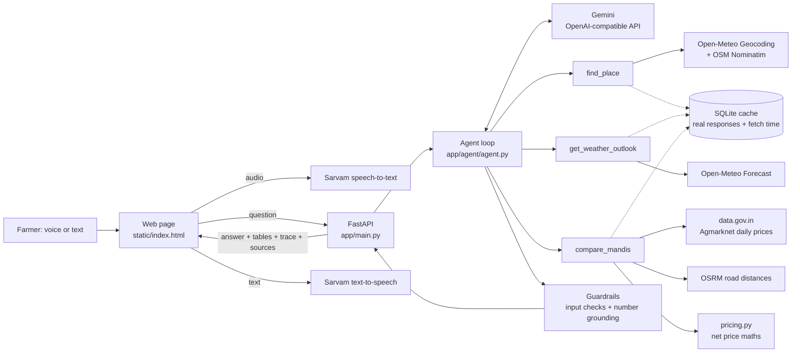

# Mandi-Mausam: sell today or hold?

A voice-first AI agent that helps a small farmer decide **whether to sell a stored crop now or hold it, and at which nearby mandi**. It reads live official mandi prices, the 7-day weather at the farmer's village and road distances, then gives one answer in English, Hindi or Marathi, with **every number traced to its source**.

Built for the **Forge GenAI Buildathon, Theme 2: Climate, Resource Infrastructure & Global Supply Resilience** (Multilingual Agritech & Resource Advisory Assistant).

> Live app: `https://<your-render-url>` · Demo video: `<link>` · Pitch deck: `<link>`

## The problem

- Onion farmers keep only about **36% of the consumer rupee** ([RBI Working Paper 08/2024](https://rbi.org.in/Scripts/PublicationsView.aspx?id=22723)).
- India loses about **₹5,156 crore of onion a year** after harvest ([NABCONS 2022, Lok Sabha answer](https://eparlib.sansad.in/bitstream/123456789/2984698/1/AU1773_tyKJYF.pdf)).
- Prices swing fast: the Lasalgaon average fell from ₹4,451 to ₹3,900 per quintal between 1 and 6 October 2026 ([Free Press Journal](https://www.freepressjournal.in/pune/nashik-egyptian-onions-fresh-kharif-arrivals-put-pressure-on-onion-prices)).

Prices sit on one app, weather on another, and storage risk is a guess. Mandi-Mausam joins them into one decision, with its working shown.

## What it does

1. The farmer asks by voice or text, e.g. *"I have 20 quintals of onion near Lasalgaon. Sell today or wait, and where?"*
2. The agent plans and calls tools:
   - `find_place` locates the village (Open-Meteo Geocoding, with OpenStreetMap Nominatim as fallback).
   - `get_weather_outlook` gets the 7-day rain and humidity, and flags storage and transport risk (Open-Meteo).
   - `compare_mandis` gets the latest official prices (data.gov.in Agmarknet feed), locates each mandi, computes road distance (OSRM) and the **price left after transport**.
3. Python code does all the money maths. The LLM only explains.
4. A grounding check makes sure every number in the answer exists in tool data. If it finds an unsupported number, the model is asked to fix it once, and anything still unsupported is flagged in the UI.
5. The answer is shown with a mandi table, a 7-day risk strip, a "How I decided" trace and sources with fetch times. It can be played aloud via Sarvam TTS.

## Architecture



| Folder | What lives there |
| --- | --- |
| `app/main.py` | HTTP routes: `/api/ask`, `/api/transcribe`, `/api/speak`, `/api/health`, and the web page |
| `app/agent/` | Agent loop, system prompt, guardrails |
| `app/tools/` | One module per data source, plus `pricing.py` for the maths |
| `app/http.py`, `app/cache.py` | Timeouts, retry, caching, source attribution |
| `app/voice.py` | Sarvam speech-to-text and text-to-speech |
| `static/` | Plain HTML, CSS and JavaScript, with no build step |
| `tests/` | Unit tests for maths, parsing, guardrails and agent-loop plumbing |

## Data sources (all live, no stored datasets)

| Data | Source | Key |
| --- | --- | --- |
| Mandi prices (₹/quintal) | [data.gov.in: Current Daily Price of Various Commodities from Various Markets (Mandi)](https://data.gov.in/resource/current-daily-price-various-commodities-various-markets-mandi), from the Agmarknet portal (Ministry of Agriculture & Farmers Welfare) | Free, `DATA_GOV_IN_API_KEY` |
| 7-day rain and humidity | [Open-Meteo Forecast API](https://open-meteo.com/) | None |
| Village and mandi locations | Open-Meteo Geocoding (GeoNames); OpenStreetMap Nominatim fallback | None |
| Road distance and drive time | OSRM public server (OpenStreetMap roads); straight-line fallback, labelled | None |
| Reasoning | Google Gemini via its OpenAI-compatible endpoint | `GEMINI_API_KEY` |
| Voice | Sarvam AI speech-to-text and Bulbul text-to-speech | `SARVAM_API_KEY` |

The cache stores **only real API responses** with their original fetch time. If an API is down, the app may show the last real response and says so. It never shows invented or sample values.

## Decision rules and their sources

| Rule | Value | Source |
| --- | --- | --- |
| Humid day (storage risk) | daily mean RH above 70% | Dry onions store best at 65–70% RH ([UC Davis Postharvest Center](https://postharvest.ucdavis.edu/node/8121)); higher RH favours rot and root growth ([WFLO Commodity Storage Manual](https://www.gcca.org/system/files/WFLO-Commodity-Storage-Manual-2018-Onions%20and%20Onion%20Sets.pdf)) |
| Rainy day (transport and handling risk) | 2.5 mm or more | India Meteorological Department definition of a rainy day |
| Storage risk for the week | high at 4+ humid days, medium at 2–3 | Our rule of thumb, shown to the user |
| Stale price | older than 3 days | Our rule; stale rows never outrank fresh ones |
| Net price | modal price − (₹/km × road km ÷ quintals) | Transport rate comes only from the farmer |

## Guardrails

- **Grounded numbers:** every number in the answer must appear in tool output or the farmer's own words, with one self-correction round, then a visible warning.
- **No invented inputs:** quantity and transport rate are used only if the farmer gave them; the agent drops values the model makes up.
- **No price forecasts:** the agent describes today's prices and weather risk, and says plainly it cannot predict prices.
- **Out of scope:** pesticide doses, loans, and legal or medical questions are referred to KVK or the Kisan Call Centre (1800-180-1551).
- **Prompt injection:** the farmer's text is treated as a question, never as instructions.
- **Resilience:** HTTP timeouts with one retry, cached real data with a timestamp when an API fails, a step limit on the agent, and clear error messages in the UI.

## Run it locally

```bash
git clone https://github.com/<you>/mandi-mausam && cd mandi-mausam
python3 -m venv .venv && source .venv/bin/activate
pip install -r requirements-dev.txt
cp .env.example .env    # then paste your three keys into .env
uvicorn app.main:app --reload
# open http://localhost:8000
python -m pytest -q     # unit tests
```

Check the live data path: `curl localhost:8000/api/health`.

## Deploy (Render, free tier)

1. Push this repo to GitHub.
2. On Render, go to **New → Blueprint**, pick the repo (it reads `render.yaml`), and paste the three keys when asked.
3. Open `https://<service>.onrender.com/api/health` and check that `weather_api` says `ok`.

Free instances sleep when idle, so open the health URL a minute before a demo.

## Limitations and next steps

- Mandis report on different days; older reports are labelled and ranked last.
- Mandi locations come from name matching and can miss small yards (they are listed as "not located").
- No price forecasting by design. A next step is to add 30-day price history and arrival volumes as evidence, not predictions.
- Next: WhatsApp and IVR access for feature phones, more crops, and FPO truckload pooling.

## Team

Built during the Forge buildathon window by a team of three. All core logic, agent workflow and UI were written during the event.
