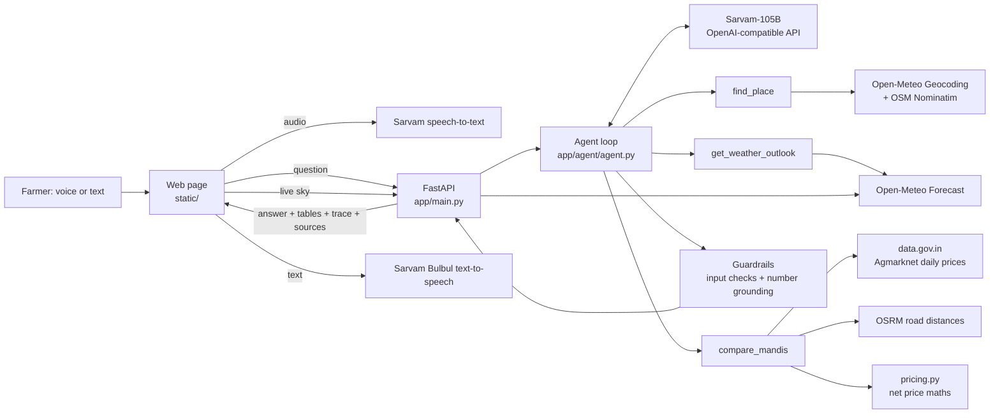

<div align="center">

# Mandi-Mausam

### Sell today, or hold?

An honest answer for the farmer standing next to her onion store.<br>
Live mandi prices, the week's weather and the money left after transport, in English, हिंदी or मराठी.<br>
**Every number on the screen is traced back to its source.**

[Live app](https://mandi-mausam.vercel.app) · [The Problem Log](PROBLEM_LOG.md) · [Demo video](#) · [Pitch deck](#)

</div>

---

## A morning in Lasalgaon

*An illustrative scene, not a real person.*

It is early morning near Lasalgaon, in Nashik district, home to Asia's biggest wholesale onion market. Sunita has 20 quintals of onion in her *kanda chawl*, the airy shed where farmers here store the crop. The sky looks heavy. A trader says prices are slipping. A neighbour says wait a week.

She has to decide, and a few days can matter: in the first week of October 2026, Lasalgaon's average onion price fell by ₹551 a quintal in five days.

Today she would piece the answer together from a commission agent, a WhatsApp forward and a weather app. **Mandi-Mausam does the piecing together for her, shows its working, and reads the answer out loud in her language.**

## Why this is hard



Most of what a shopper pays never reaches the person who grew the crop. The farmer's best lever is *when* and *where* she sells, and that is exactly the decision with the least support.



Prices move faster than a farmer can check them. Selling too early can leave money on the table; waiting can cost even more.



Waiting is not free either. Stored onions spoil when the air is too humid, so the weather forecast is part of the price decision.

The pieces of information exist: mandi prices on one website, weather on another, the road on a map, transport costs in the farmer's head. Nobody puts them together into one answer she can trust.

## What Mandi-Mausam does

She asks one question, by voice or text: *"I have 20 quintals of onion near Lasalgaon. Should I sell today or wait, and where?"*



The AI agent finds her village, checks the next seven days of rain and humidity, pulls today's official prices from nearby mandis, measures the road to each one, and works out what she actually keeps. Then it explains its recommendation in a few plain sentences, and can read them aloud.



The highest quoted price is not always the best deal. Mandi-Mausam compares mandis on the money left after transport, using the rate the farmer tells it.

## How it stays honest

- **It never invents a number.** Every price, distance, date and percentage in the answer must appear in the live data. If the AI model writes a number it cannot support, the answer is sent back to be fixed, and anything still unsupported is flagged on screen.
- **It never guesses your costs.** Quantity and transport rate come only from the farmer. If she has not said them, it asks.
- **It does the maths in plain code.** The AI model chooses the steps and explains the result; ordinary Python does every rupee of arithmetic.
- **It does not predict prices.** It shows today's prices, how old each report is, and what the weather means for her stored crop.
- **It shows how old every price is.** Mandis report on different days. Older reports are labelled and never ranked above fresh ones.
- **It knows what it should not answer.** Pesticide doses, loans and medical or legal questions go to the local Krishi Vigyan Kendra (KVK) or the Kisan Call Centre (1800-180-1551).
- **It never leaves her with a blank screen.** If the AI model stumbles, the app shows a plain summary built straight from the live data, and says so.

Every answer comes with a **"How I decided"** panel listing each step the agent took, and a **Sources** list with the time each one was fetched.

## What you see on screen

- **Live progress.** Each real step (finding the village, checking the weather, comparing mandis) appears the moment the server finishes it, with its time. Nothing is faked to look busy.
- **One clear answer.** A large "Sell at ..." or "Hold" headline, the rupees per quintal and in total that she keeps (taken straight from the data, not from the model's wording), the report date, road distance and storage risk.
- **Three languages.** The whole interface and the answer work in English, Hindi and Marathi, and the answer can be read aloud.
- **Hands-free voice.** Speak the question, and the answer is read back aloud.
- **A live sky.** The home page shows Lasalgaon's weather right now from Open-Meteo: rain falls only if it is raining there, and mist rises when humidity is above the 70% onion-storage line. If the weather service is down it says so instead of inventing a sky.

## Under the hood



| Folder | What lives there |
| --- | --- |
| `app/main.py` | Web routes: `/api/ask_stream` (live step-by-step answer), `/api/ask`, `/api/transcribe`, `/api/speak`, `/api/sky`, `/api/health`, and the page itself |
| `app/agent/` | The agent loop, its instructions, and the guardrails |
| `app/tools/` | One module per data source, plus `pricing.py` for the money maths |
| `app/http.py`, `app/cache.py` | Timeouts, retries, caching of real responses, source attribution |
| `app/voice.py` | Sarvam speech-to-text and text-to-speech |
| `static/` | The web page: plain HTML, CSS and JavaScript, no build step |
| `tests/` | 33 tests covering the maths, parsing, guardrails, live-sky reading and the agent loop |
| `scripts/` | Live checks for the AI model and voice routes, and `run_edge_cases.py`, our edge-case test run (writes `docs/edge_case_report.md`) |
| `docs/` | The figures in this README and how they are made (`make_figures.py`) |

### Data sources (all live, nothing stored in advance)

| What | Where it comes from | Key |
| --- | --- | --- |
| Mandi prices (₹ per quintal) | [data.gov.in: Current Daily Price of Various Commodities from Various Markets (Mandi)](https://data.gov.in/resource/current-daily-price-various-commodities-various-markets-mandi), published from the Agmarknet portal (Ministry of Agriculture & Farmers Welfare) | Free, `DATA_GOV_IN_API_KEY` |
| 7-day rain and humidity | [Open-Meteo Forecast API](https://open-meteo.com/) | None |
| Village and mandi locations | Open-Meteo Geocoding (GeoNames), with OpenStreetMap Nominatim as fallback | None |
| Road distance and drive time | OSRM public server (OpenStreetMap roads); labelled straight-line fallback | None |
| Reasoning and explanation | [Sarvam-105B](https://docs.sarvam.ai/) via its OpenAI-compatible API (any OpenAI-compatible model can be configured) | `SARVAM_API_KEY` |
| Voice in and out | Sarvam speech-to-text and Bulbul text-to-speech | `SARVAM_API_KEY` |

The cache keeps **only real API responses**, each with the time it was fetched. If a source is down, the app may show the last real response and says when it was fetched. It never shows sample or made-up values.

### The decision rules, and where they come from

| Rule | Value | Source |
| --- | --- | --- |
| Humid day (storage risk) | Daily average humidity above 70% | Dry onions store best at 65–70% relative humidity ([UC Davis Postharvest Center](https://postharvest.ucdavis.edu/node/8121)); more humidity brings rot and root growth ([WFLO storage manual](https://www.gcca.org/system/files/WFLO-Commodity-Storage-Manual-2018-Onions%20and%20Onion%20Sets.pdf)) |
| Rainy day (transport and handling risk) | 2.5 mm of rain or more | India Meteorological Department's definition of a rainy day |
| Storage risk for the week | High at 4+ humid days, medium at 2–3 | Our rule of thumb, shown to the user |
| Stale price | Older than 3 days | Our rule; stale rows never outrank fresh ones |
| Money left after transport | Price − (₹ per km × road km ÷ quintals) | The transport rate always comes from the farmer |

## Run it yourself

```bash
git clone https://github.com/KunalwritesCode/mandi-mausam && cd mandi-mausam
python3 -m venv .venv && source .venv/bin/activate
pip install -r requirements-dev.txt
cp .env.example .env      # add your data.gov.in and Sarvam keys
uvicorn app.main:app --reload
# open http://localhost:8000
python -m pytest -q       # 33 tests
```

`curl localhost:8000/api/health` makes one live weather call, so you can see the data path is working.

**Deploy on Vercel in Mumbai (free Hobby plan):** import this repo, set the Application Preset to **Other**, and add `SARVAM_API_KEY`, `DATA_GOV_IN_API_KEY`, `LLM_BASE_URL`, `LLM_MODEL` and `CACHE_PATH=/tmp/cache.sqlite3`. `vercel.json` pins the function to Mumbai (`bom1`). That matters: data.gov.in refuses connections from servers outside India, which we found the hard way (see the Problem Log, row 14). Open `/api/health` to confirm that both the weather and the mandi price services are reachable.

## What we have not solved yet

- **Hosting must be in India.** The mandi price API only answers Indian addresses, so the app runs in Mumbai. Weather has a second real source (MET Norway) in case Open-Meteo rate-limits a shared host.
- **Thin days.** Mandis report on different days, and on Sundays very few do. The app shows what was reported and when, but it cannot conjure a price for a mandi that stayed quiet.
- **Name matching.** Mandi locations come from matching names on a map. Small yards can be missed; they are counted, never guessed.
- **No price forecasts, by design.** A next step is adding the past month's prices and arrival volumes as evidence, not predictions.
- **Next:** WhatsApp and phone-call access for farmers without smartphones, more crops, and truckload pooling for Farmer Producer Organisations.

## How it was built

The whole build, including every wrong turn, is in **[The Problem Log](PROBLEM_LOG.md)**: what we tested, what failed, why, and how we fixed it.

**Credits.** The home-page footage was generated with Kling AI and is labelled on screen as illustrative; it carries no data. The page uses the open-source fonts Teko and Mukta (SIL Open Font License, licences in `static/fonts/`), self-hosted so the demo makes no outside font requests.

## Sources

- [RBI Working Paper 08/2024: Vegetables Inflation in India, a Study of Tomato, Onion and Potato](https://rbi.org.in/Scripts/PublicationsView.aspx?id=22723)
- [Lok Sabha unstarred question 1773, 5 Dec 2024: post-harvest losses (NABCONS 2022)](https://eparlib.sansad.in/bitstream/123456789/2984698/1/AU1773_tyKJYF.pdf)
- [Free Press Journal, 6 Oct 2026: Lasalgaon onion prices under pressure](https://www.freepressjournal.in/pune/nashik-egyptian-onions-fresh-kharif-arrivals-put-pressure-on-onion-prices)
- [Deccan Herald: Lasalgaon, Asia's biggest wholesale onion market](https://www.deccanherald.com/india/maharashtra/day-after-protest-over-drop-in-prices-onion-auctions-start-at-lasalgaon-apmc-3441366)
- [MET Norway Locationforecast 2.0 (backup weather source, CC BY 4.0)](https://api.met.no/weatherapi/locationforecast/2.0/documentation)
- [UC Davis Postharvest Technology Center: onion storage conditions](https://postharvest.ucdavis.edu/node/8121)
- [WFLO Commodity Storage Manual: onions](https://www.gcca.org/system/files/WFLO-Commodity-Storage-Manual-2018-Onions%20and%20Onion%20Sets.pdf)

## Team

Built by a team of three for the Forge GenAI Buildathon (Theme 2: Climate, Resource Infrastructure & Global Supply Resilience). All core logic, the agent workflow and the interface were written during the event. We used Claude as an AI assistant during the build; every member of the team can walk through every file.
